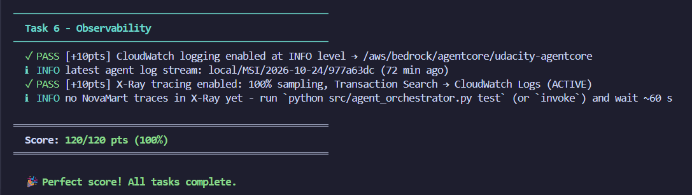
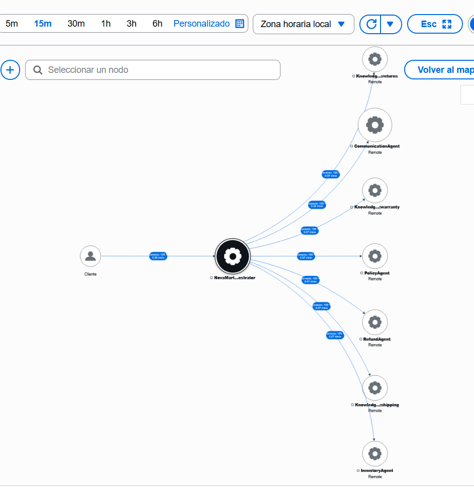

# NovaMart Multi-Agent Customer Support

**Udacity – Capstone Project 3.3: Enterprise Multi-Agent Architecture with Amazon Bedrock AgentCore**

A customer support system with 5 Strands agents (Orchestrator → Inventory, Policy, Refund,
Communication). The PolicyAgent runs 3 retriever sub-agents **in parallel**, one per Bedrock
Knowledge Base. The system runs on AgentCore Runtime with a Bedrock Guardrail, AgentCore Memory,
CloudWatch logs and X-Ray tracing.

**Result: 120 / 120 in `python tests/test_agent.py all`**

---

## Submission files

| File | Content |
|---|---|
| `src/agent_orchestrator.py` | Completed code (Tasks 2, 3, 4, 6) |
| `.env` | KB IDs, Runtime ARN, Guardrail ID and version (no AWS credentials) |
| `fix_guardrail.py` | Helper that tests the guardrail and publishes a new version |
| `screenshots/` | All screenshots (see below) |

---

## 1. Test suite – 120/120

| Screenshot | Shows |
|---|---|
| `screenshots/test_agent/phase2-4.png` | Tasks 2, 3 and 4 pass |
| `screenshots/test_agent/phase5a.png`, `phase5b.png` | Task 5: 3 KBs ACTIVE, Titan v2, synced, parallel retrieval returns passages from all 3 KBs |
| `screenshots/test_agent/phase6.png` | Task 6 passes and the final score **120/120** |

---

## 2. `python src/agent_orchestrator.py test` – 3 scenarios + X-Ray

Each scenario prints `X-Ray trace ... published successfully`.

| Scenario | Routing | Screenshots |
|---|---|---|
| CUST-001: "I want to return my wireless headphones from order ORD-27176" | Orchestrator → Inventory → Refund → Communication | `screenshots/CUST-001/1.png` – `4.png`, map: `map1.png` |
| CUST-002: "What is the return policy for premium customers?" | Orchestrator → Policy (3 KB retrievers in parallel) → Communication | `screenshots/CUST-002/1.png` – `6.png`, map: `map.png` |
| CUST-003: "How much would 5 items at $29.99 be with a 10% discount?" | Orchestrator calculates ($134.96) → Communication | `screenshots/CUST-003/1.png` – `2.png`, map: `map.png` |

Note for CUST-001: the order had already been returned in an earlier run, so the RefundAgent
correctly answered that the return is already in progress (reference `RET-E0EC7D52`) and did not
create a second one.

### X-Ray Service Map

`NovaMart-Orchestrator` is connected to `InventoryAgent`, `RefundAgent`, `PolicyAgent`,
`CommunicationAgent` and the 3 Knowledge Base nodes (`KnowledgeBase:returns`, `:shipping`,
`:warranty`).

---

## 3. Knowledge Bases (Task 5)

| Knowledge Base | ID | S3 prefix | Vector store | Vector index |
|---|---|---|---|---|
| `novamart-returns-kb` | `YTAKMTVDEI` | `policies/returns/` | S3 Vectors (stack VectorStoreBucket) | `returns-policy-index` |
| `novamart-shipping-kb` | `QORQB9ZL6P` | `policies/shipping/` | S3 Vectors (stack VectorStoreBucket) | `shipping-policy-index` |
| `novamart-warranty-kb` | `TARQWNEBAC` | `policies/warranty/` | S3 Vectors (stack VectorStoreBucket) | `warranty-policy-index` |

All three use `amazon.titan-embed-text-v2:0`, and each data source was synced.

| Screenshot | Shows |
|---|---|
| `screenshots/kbs.png` | The 3 Knowledge Bases, status Available |
| `screenshots/index.png` | The 3 vector indexes created by the CloudFormation stack |
| `screenshots/kb/returns_store.png`, `shipping_store.png`, `warranty_store.png` | Embedding model, S3 Vectors bucket and index of each KB |
| `screenshots/kb/returns_sync.png`, `shipping_sync.png`, `warranty_sync.png` | Data source of each KB with a completed sync |

---

## Implementation summary

- **Task 2:** InventoryAgent only reports facts (Orders table composite key, tier and return
  window). RefundAgent reads them from WorkflowState and applies 30 days (Standard) or 60 days
  (Premium). PolicyAgent runs 3 retriever agents with `ThreadPoolExecutor(max_workers=3)` +
  `as_completed()`. The Orchestrator (Haiku 4.5, temperature 0.0) follows the 6 routing rules
  and always calls CommunicationAgent last. Every routing tool reads WorkflowState, runs the
  worker, and writes the result with optimistic locking (`expected_version`).
- **Task 3:** Guardrail with content filters (HIGH/MEDIUM), PII (block cards and SSNs,
  anonymize email and phone), 3 denied topics (Standard tier), profanity list, and a numbered
  version. Deployed with the AgentCore CLI (PUBLIC, HTTP, stack execution role, KB and
  guardrail environment variables).
- **Task 4:** AgentCore Memory with `summaryMemoryStrategy` and `eventExpiryDuration=7`.
- **Task 6:** `loggingConfiguration` (CloudWatch INFO + X-Ray `samplingRate=1.0`) applied with
  `apply_observability_config()` inside `try/except`.

**Guardrail fix:** the first guardrail blocked the math scenario because the word "discount"
matched the `pricing_negotiations` topic. I made the topic definition more precise (haggling or
asking NovaMart to change an advertised price). `fix_guardrail.py` tested 7 sentences (math,
return and policy questions allowed; negotiation, competitor and legal threat blocked) and
published a new version only after all checks passed.