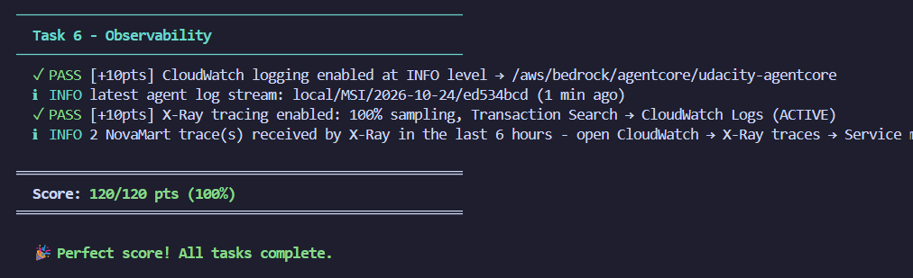
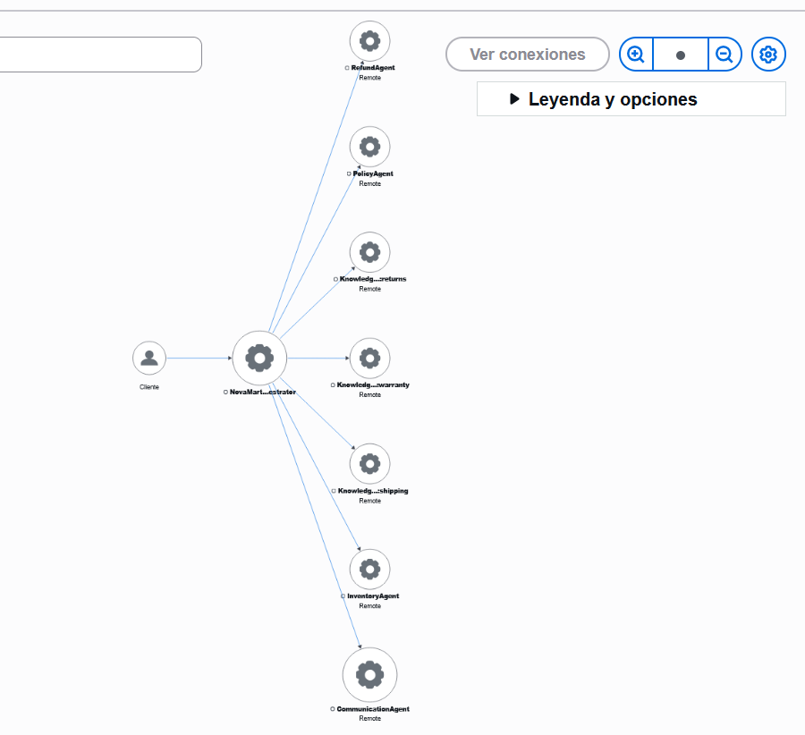
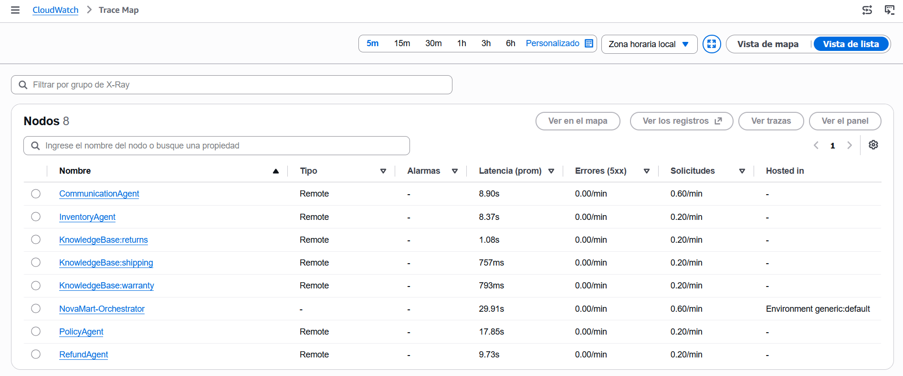

# NovaMart Multi-Agent Customer Support System

**Udacity – Capstone Project 3.3: Enterprise Multi-Agent Architecture with Amazon Bedrock AgentCore**

This project is a multi-agent customer support system for NovaMart, a fictional online store.
It uses the **Strands Agents SDK**, **Amazon Bedrock** and **Amazon Bedrock AgentCore**.
The system reads a customer request, sends it to the right specialist agent, finds information
in DynamoDB and in three Bedrock Knowledge Bases, and writes a final answer for the customer.
It also has safety guardrails, session memory, and full tracing with CloudWatch and X-Ray.

---

## Results

| Check | Result |
|---|---|
| Automated test suite (`python tests/test_agent.py all`) | **120 / 120** |
| X-Ray Service Map | Full call chain: Orchestrator → worker agents → Knowledge Bases |



---

## Submission files

| File | Description |
|---|---|
| `src/agent_orchestrator.py` | Completed implementation (Tasks 2, 3, 4 and 6) |
| `.env` | Knowledge Base IDs, AgentCore Runtime ARN and Guardrail ID/version (no AWS credentials) |
| `screenshots/test/test_score.png` | Test suite result: 120/120 |
| `screenshots/x-ray/service_map.png` | X-Ray Service Map after `python src/agent_orchestrator.py test` |
| `screenshots/x-ray/service_list.png` | X-Ray trace list for the same run (easier to read than the map) |

---

## Architecture

```
Customer Request
      │
OrchestratorAgent  (Claude Haiku 4.5, temperature 0.0)
      │
   ┌──┴───────────────┬──────────────────┬────────────────────┐
   │                  │                  │                    │
InventoryAgent    PolicyAgent        RefundAgent      CommunicationAgent
(DynamoDB)        (multi-agent RAG)  (DynamoDB)       (final answer)
                      │
      ┌───────────────┼────────────────┐
ReturnsRetriever  ShippingRetriever  WarrantyRetriever
(Returns KB)      (Shipping KB)      (Warranty KB)
      └──────── run in PARALLEL ────────┘

Shared state: DynamoDB WorkflowState table (optimistic locking)
```

| Agent | Model | Temperature | Tools |
|---|---|---|---|
| OrchestratorAgent | Claude Haiku 4.5 (`config.ORCHESTRATOR_MODEL_ID`) | 0.0 | `initialize_session`, `route_to_inventory_agent`, `route_to_policy_agent`, `route_to_refund_agent`, `route_to_communication_agent` |
| InventoryAgent | Claude Sonnet 4.5 (`config.WORKER_MODEL_ID`) | 0.1 | `check_order_status`, `get_customer_tier`, `list_customer_orders` |
| RefundAgent | Claude Sonnet 4.5 | 0.1 | `get_inventory_context`, `initiate_refund` |
| PolicyAgent | Claude Sonnet 4.5 | 0.2 | `search_all_policies` |
| 3 × PolicyRetrieverAgent | Claude Sonnet 4.5 | 0.0 | one KB retrieval tool each |
| CommunicationAgent | Claude Sonnet 4.5 | 0.3 | `get_full_workflow_context` |

All model IDs come from `config.py`. No model ID is hardcoded.

---

## What I implemented

### Task 2 – Multi-agent graph

- **InventoryAgent** only collects facts and never decides eligibility. `check_order_status` uses
  the composite key of the Orders table (`customer_id` + `order_id`) and also returns
  `days_since_order`. `get_customer_tier` returns the tier and the return window
  (Standard = 30 days, Premium = 60 days). It does not return email or phone, so less personal
  data moves between agents.
- **RefundAgent** always reads the InventoryAgent facts from WorkflowState first. Then it
  applies the window for the customer tier (30 or 60 days) and checks the order status.
  Only when the order is eligible does it call `initiate_refund`. This tool updates the order in
  DynamoDB (`status = return_requested`) and creates a return reference (`RET-XXXXXXXX`).
- **PolicyAgent (multi-agent RAG)** creates three retriever sub-agents:
  `ReturnsPolicyRetrieverAgent`, `ShippingPolicyRetrieverAgent` and `WarrantyPolicyRetrieverAgent`.
  Each one calls `retrieve_from_knowledge_base()` with its own KB ID. The `search_all_policies`
  tool runs the three retrievers **in parallel** with `ThreadPoolExecutor(max_workers=3)` and
  `as_completed()`, and then merges the results in a fixed order (Returns, Shipping, Warranty).
- **CommunicationAgent** reads the full WorkflowState and writes a warm, professional
  answer. It uses only the facts found by the other agents.
- **OrchestratorAgent** follows the six routing rules:
  1. Always call `initialize_session` first.
  2. Order / return / refund → InventoryAgent, then RefundAgent.
  3. Policy questions → PolicyAgent.
  4. Account questions ("what is my tier?") → InventoryAgent, never PolicyAgent.
  5. Math questions → the orchestrator calculates by itself (rounding only at the end) and
     does not call Inventory, Policy or Refund.
  6. Always call `route_to_communication_agent` as the **last** step. The orchestrator never
     writes the final answer itself.

  Every routing tool follows the same pattern: **read WorkflowState → run the worker → write the
  result with `_update_workflow_state()` and the `expected_version` read before the call**
  (optimistic locking).

### Task 3 – Guardrail and AgentCore Runtime

- `create_guardrail()` creates `udacity-agentcore-guardrail` with:
  - Content filters: SEXUAL, VIOLENCE, HATE = HIGH; INSULTS, MISCONDUCT = MEDIUM.
  - PII: credit card numbers and SSNs = BLOCK; email and phone = ANONYMIZE.
  - Denied topics (Standard tier + `us.guardrail.v1:0` cross-region profile): competitor
    products, pricing negotiations and legal threats. "Pricing negotiations" is defined as
    haggling or asking to change an advertised price, so a normal calculation with a given price
    and discount (the math scenario) is still allowed.
  - Managed profanity word list.
  - A published, numbered version (`create_guardrail_version()`), not DRAFT.
- `deploy_to_agentcore_runtime()` sets the runtime environment variables (region, project name,
  3 KB IDs, log group, guardrail ID and version), then calls
  `agentcore_cli.configure_runtime(network_mode='PUBLIC', protocol='HTTP', execution_role_arn=config.AGENTCORE_ROLE_ARN)`,
  `agentcore_cli.deploy()` and `agentcore_cli.deployed_runtime_arn()`.
  The provided `_apply_guardrail()` attaches the guardrail to every agent model.

### Task 4 – Memory

- `configure_memory()` calls `create_memory()` with a `summaryMemoryStrategy`
  (SESSION_SUMMARY), `eventExpiryDuration=7`, a name, a description and a `clientToken`.

### Task 5 – Knowledge Bases (AWS Console)

Three self-managed Knowledge Bases, all with the **Titan Text Embeddings V2** model and the
**S3 Vectors** bucket created by the CloudFormation stack:

| Knowledge Base | S3 prefix | Vector index |
|---|---|---|
| `novamart-returns-kb` | `policies/returns/` | `returns-policy-index` |
| `novamart-shipping-kb` | `policies/shipping/` | `shipping-policy-index` |
| `novamart-warranty-kb` | `policies/warranty/` | `warranty-policy-index` |

Each data source was synced, and the three KB IDs are in `.env`.

### Task 6 – Observability

- `configure_observability()` builds a `loggingConfiguration`:
  - CloudWatch: `config.AGENT_LOG_GROUP`, log level INFO, enabled.
  - X-Ray: enabled, `samplingRate = 1.0` (100% for development).

  It passes this dict to `apply_observability_config()` inside `try/except`.

---

## End-to-end test (Task 7)

`python src/agent_orchestrator.py test` runs three scenarios. The X-Ray traces show the expected
routing:

| Scenario | Expected routing |
|---|---|
| "I want to return my wireless headphones from order ORD-27176" (CUST-001) | Orchestrator → Inventory → Refund → Communication |
| "What is the return policy for premium customers?" (CUST-002) | Orchestrator → Policy (3 parallel KB retrievers) → Communication |
| "How much would 5 items at $29.99 be with a 10% discount?" (CUST-003) | Orchestrator → Communication only |

### X-Ray Service Map



### X-Ray trace list

The map is small in the screenshot, so this list shows the same traces in a clearer way.



---

## Design decisions

- **Stateless workers:** each worker agent starts with an empty conversation for every call.
  All shared context goes through the DynamoDB WorkflowState, so one session cannot leak
  into another session.
- **Optimistic locking:** every write uses the `version` read before the worker ran, so
  concurrent updates cannot overwrite each other.
- **Fail-safe tools:** tools return clear "not found" messages instead of crashing, and the
  agents are told never to invent data.
- **Less personal data:** customer email and phone are not sent to the agents, and the guardrail
  also anonymizes them.
- **Cost control:** Haiku 4.5 handles routing (fast and cheap) and Sonnet 4.5 handles reasoning.
  The parallel retrieval also reduces the time of policy questions.

---

## Notes

- `.env` contains only resource IDs. It does not contain AWS credentials.
- After the review, all resources are removed with:
  `python infrastructure/cleanup.py --yes --disable-transaction-search`